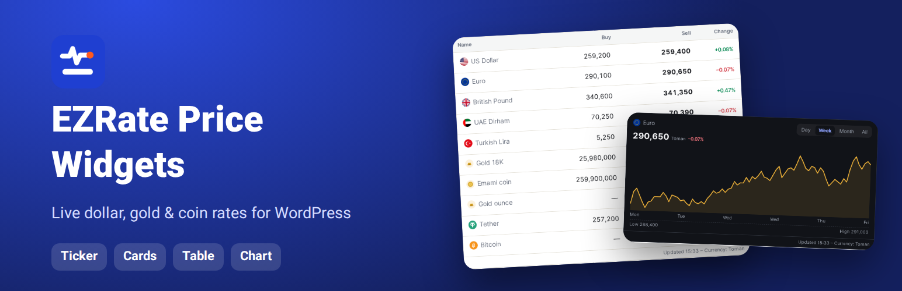
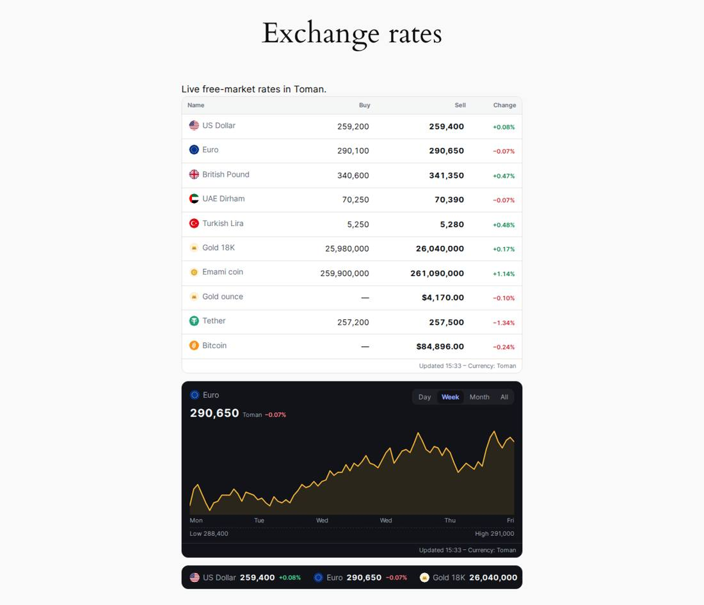

# EZRate Price Widgets for WordPress — Iran Dollar, Gold & Coin Rates

[فارسی](README.md) · [Download the latest release](../../releases/latest)

**EZRate Price Widgets** shows Iran's live free-market rates on your WordPress site: the **US dollar, euro, UAE dirham, Turkish lira and 20+ other currencies, 18k and 24k gold, Emami and Bahar Azadi coins, the gold ounce, USDT, Bitcoin and other crypto** — in Toman, in Persian or English.

Everything is set up from your own dashboard. **No account, no API key, no code.**

## Five widget types

- **Moving ticker** — prices scroll like a news ticker.
- **Price bar** — one row of prices.
- **Price cards** — 1–6 columns for a sidebar or home page.
- **Price table** — name, buy, sell and 24-hour change.
- **Chart** — one asset with day / week / month / all ranges.

## Features

- Pick prices and their order (up to 20), language (Persian RTL or English), light or dark theme.
- Your own colours, corner radius, text size, your theme's font; live preview while editing.
- Place it with a **shortcode**, the **"EZRate price widget" block**, the **classic widget**, or a **fixed bar at the top or bottom of every page**.
- Quick shortcode: `[ezrate_widget type="cards" assets="usd,eur,g18,emami" lang="en" theme="dark"]`
- **Fast:** rendered on your server from cached prices — no external scripts, no iframes; about 6 KB CSS and 1 KB JS, only on pages with a widget.
- Prices refresh in the background every 30 minutes; if the data service is unreachable, the last prices stay.

## Install

1. Download the zip from [Releases](../../releases/latest).
2. WordPress › Plugins › Add New › **Upload Plugin** › choose the zip › Install › Activate.
3. **EZRate › Widgets**: a first ticker is ready — click it to choose prices, language and colours, or **Add widget**.
4. Put the shortcode in a post, page or widget area, or add the "EZRate price widget" block.

A bilingual guide is inside the plugin under **EZRate › Help**.

## External service and privacy

The plugin downloads prices from `https://api.ezrate.me/v1/wp/data` every 30 minutes. No data about your visitors is sent. Links to ezrate.me are added only if you turn them on. [Terms](https://ezrate.me/legal/terms/en) · [Privacy](https://ezrate.me/legal/privacy/en)

## Related

[EZRate API](https://github.com/ezrate-me/ezrate-api) · [Widgets for any website](https://github.com/ezrate-me/ezrate-widgets) · [ezrate.me](https://ezrate.me/en)

License: GPLv2 or later.
