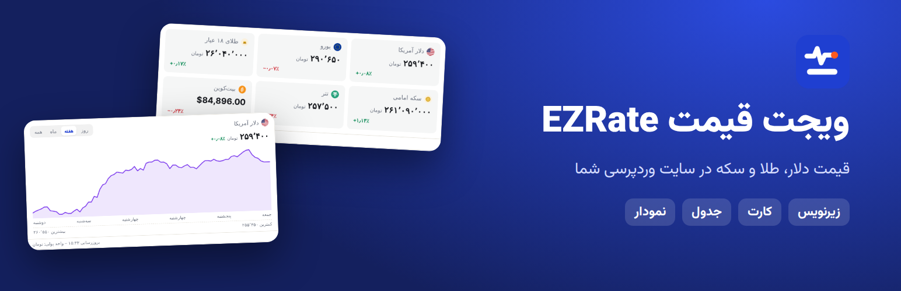
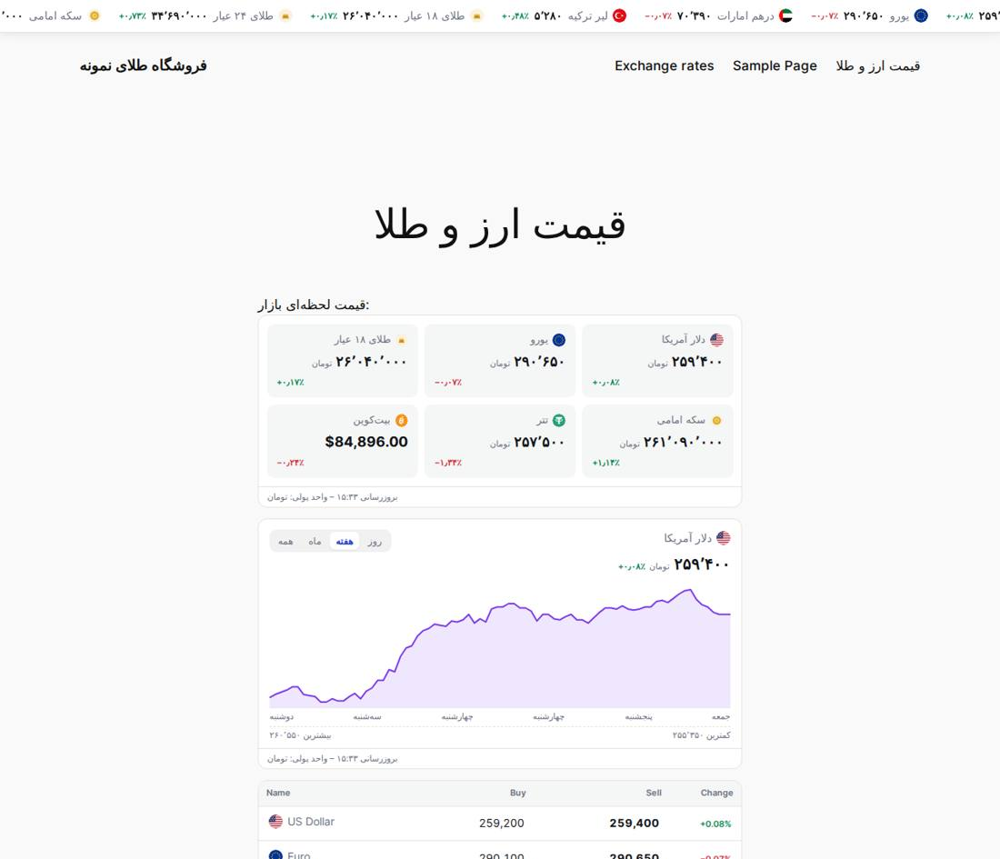
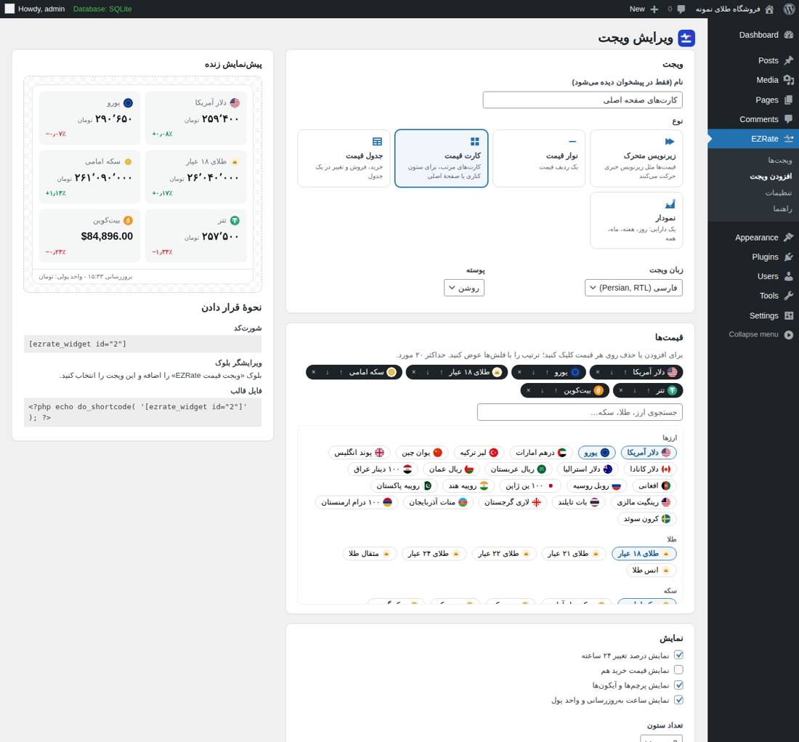

<div dir="rtl">

# افزونهٔ وردپرس قیمت ارز، طلا و سکه — EZRate Price Widgets

[English](README.en.md) · [دانلود آخرین نسخه](../../releases/latest)



**EZRate Price Widgets** قیمت لحظه‌ای بازار آزاد ایران را در سایت وردپرسی شما نشان می‌دهد: **دلار، یورو، درهم، لیر و بیش از ۲۰ ارز دیگر، طلای ۱۸ و ۲۴ عیار، سکه امامی و بهار آزادی، انس جهانی، تتر، بیت‌کوین و ارزهای دیجیتال**، به تومان و به فارسی یا انگلیسی.

همه‌چیز از پیشخوان وردپرس تنظیم می‌شود: **بدون حساب کاربری، بدون کلید API و بدون کدنویسی.**



## پنج نوع ابزارک

- **نوار متحرک (تیکر):** قیمت‌ها مثل زیرنویس خبر حرکت می‌کنند.
- **نوار قیمت:** یک ردیف ثابت از قیمت‌ها.
- **کارت قیمت:** ۱ تا ۶ ستون، مناسب ستون کناری و صفحهٔ اصلی.
- **جدول قیمت:** نام، خرید، فروش و تغییر ۲۴ ساعته.
- **نمودار:** یک دارایی با بازهٔ روز، هفته، ماه و همه.

## امکانات

- انتخاب قیمت‌ها و ترتیبشان (تا ۲۰ قیمت)، زبان (فارسی راست‌به‌چپ یا انگلیسی)، پوستهٔ روشن یا تیره.
- رنگ‌های دلخواه، گردی گوشه‌ها، اندازهٔ متن، فونت قالب سایت. پیش‌نمایش زنده هنگام ویرایش.
- نمایش با **کد کوتاه**، **بلوک گوتنبرگ «EZRate price widget»**، **ابزارک کلاسیک**، یا **نوار ثابت بالا/پایین همهٔ صفحه‌ها**.
- کد کوتاه سریع بدون ذخیرهٔ ابزارک:

</div>

```
[ezrate_widget type="cards" assets="usd,eur,g18,emami" lang="fa" theme="dark"]
```

<div dir="rtl">

- **سریع:** ابزارک‌ها روی سرور شما از نسخهٔ ذخیره‌شدهٔ قیمت‌ها ساخته می‌شوند؛ بدون اسکریپت خارجی و iframe. حدود ۶ کیلوبایت CSS و ۱ کیلوبایت جاوااسکریپت، فقط در صفحه‌هایی که ابزارک دارند.
- قیمت‌ها هر ۳۰ دقیقه در پس‌زمینه به‌روز می‌شوند. اگر سرویس داده در دسترس نباشد، آخرین قیمت‌ها روی صفحه می‌مانند.



## نصب

1. فایل zip را از [Releases](../../releases/latest) دانلود کنید.
2. وردپرس › افزونه‌ها › افزودن › **بارگذاری افزونه** › فایل zip › نصب › فعال‌سازی.
3. **EZRate › ابزارک‌ها**: اولین تیکر آماده است. روی آن بزنید تا قیمت‌ها، زبان و رنگ‌ها را انتخاب کنید، یا **افزودن ابزارک** را بزنید.
4. کد کوتاه را در نوشته، برگه یا ابزارک بگذارید، یا بلوک «EZRate price widget» را اضافه کنید.

راهنمای کامل دوزبانه داخل خود افزونه، در **EZRate › راهنما** است.

## سؤال‌های رایج

**رایگان است؟** بله، هم افزونه و هم داده‌ها رایگان‌اند.

**قیمت‌ها هر چند وقت به‌روز می‌شوند؟** هر ۳۰ دقیقه. برای قیمت دقیقه‌ای از [ویجت‌های حساب EZRate](https://github.com/ezrate-me/ezrate-widgets) استفاده کنید.

**قیمت‌ها از کجا می‌آیند؟** از [EZRate](https://ezrate.me/fa): میانهٔ معاملات واقعی بازار آزاد برای ارز، طلا و سکه؛ رمزارزها از صرافی‌های بزرگ جهانی.

**سایت را کند می‌کند؟** خیر. قیمت‌ها در دیتابیس سایت شما ذخیره می‌شوند و صفحه‌ها هرگز منتظر سرویس داده نمی‌مانند.

## سرویس خارجی و حریم خصوصی

افزونه هر ۳۰ دقیقه قیمت‌ها را از `https://api.ezrate.me/v1/wp/data` می‌گیرد. هیچ اطلاعاتی از بازدیدکنندگان سایت شما ارسال نمی‌شود. لینک به ezrate.me فقط وقتی اضافه می‌شود که خودتان در تنظیمات روشنش کنید. [شرایط استفاده](https://ezrate.me/legal/terms/fa) · [حریم خصوصی](https://ezrate.me/legal/privacy/fa)

## پروژه‌های مرتبط

- [API قیمت ارز و طلا](https://github.com/ezrate-me/ezrate-api)
- [ویجت قیمت ارز برای هر سایت](https://github.com/ezrate-me/ezrate-widgets)
- [ezrate.me](https://ezrate.me/fa): [قیمت دلار](https://ezrate.me/usd/fa)، [قیمت طلا](https://ezrate.me/gold/fa)، [قیمت سکه](https://ezrate.me/coin/fa)

مجوز: GPLv2 یا بالاتر.

</div>
